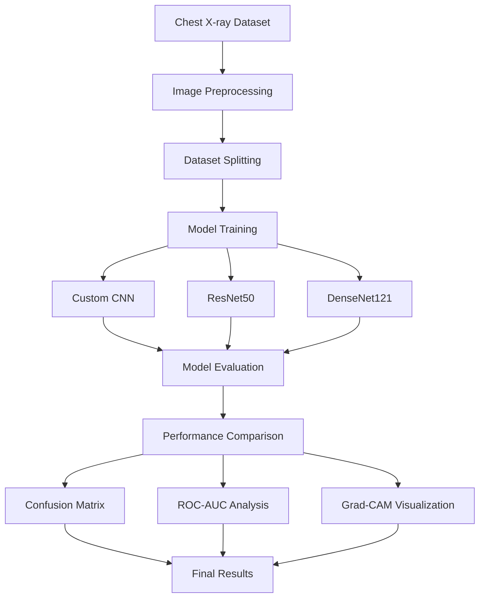
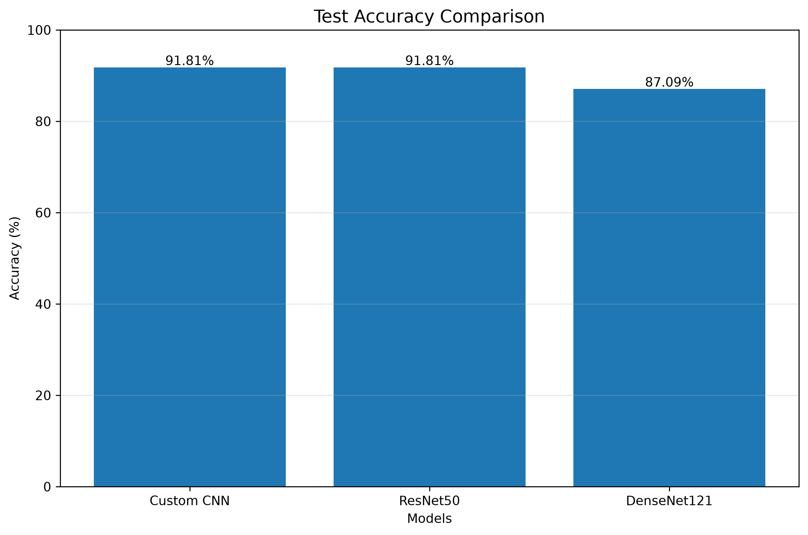
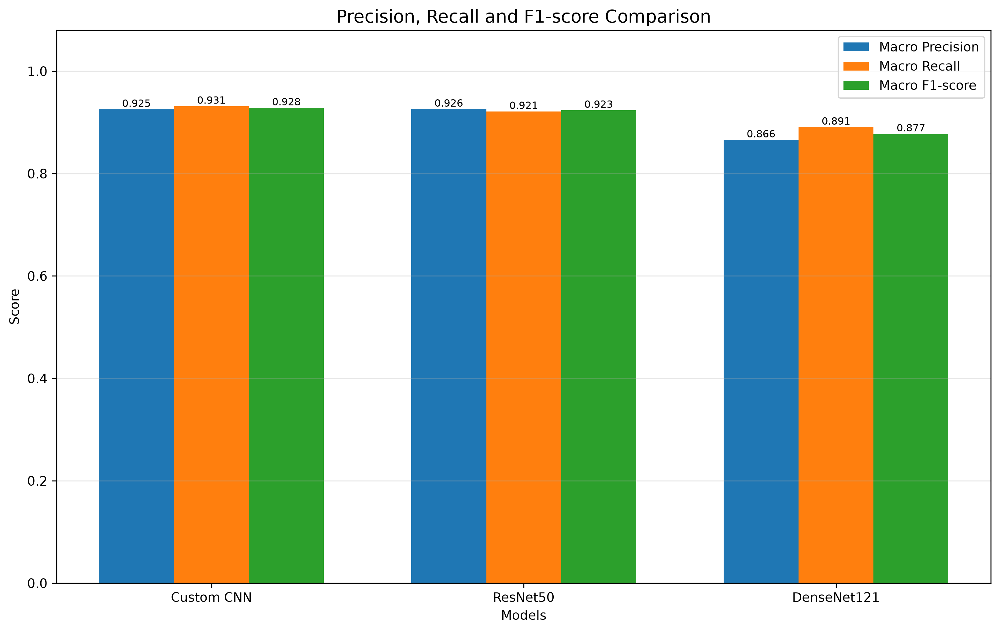
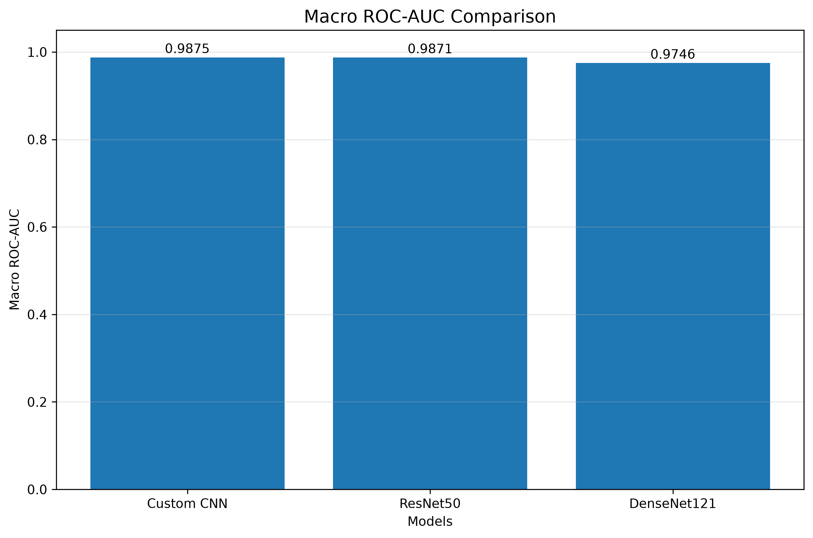
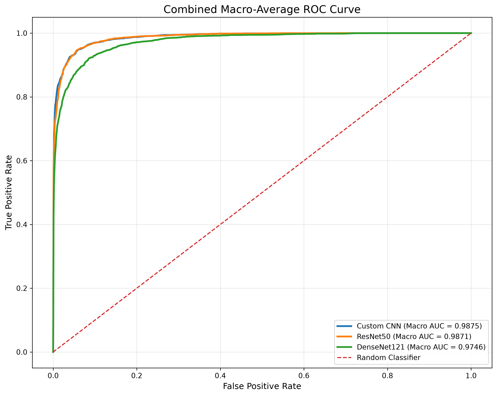

# COVID-19 Detection from Chest X-ray Images Using Deep Learning
[](https://github.com/santhoshmadhavan016-ops/Advanced-COVID19-Detection-CNN)


## Project Overview

This project presents a deep-learning-based approach for classifying chest X-ray images into four different lung conditions:

- COVID
- Normal
- Viral Pneumonia
- Lung Opacity

The system implements and compares three Convolutional Neural Network (CNN) architectures:

1. Custom CNN
2. ResNet50
3. DenseNet121

The models are trained and evaluated using a dataset containing **21,165 chest X-ray images**.

The main objective is to compare the performance of different deep learning architectures using classification metrics, ROC-AUC analysis, confusion matrices, and Grad-CAM visualizations.

> **Disclaimer:** This project is developed for academic and research purposes only. It is not clinically validated and must not be used as a medical diagnostic tool.

---

## Project Objectives

- Develop a deep learning system for four-class chest X-ray classification.
- Implement Custom CNN, ResNet50, and DenseNet121 architectures.
- Compare model performance using standard evaluation metrics.
- Analyze class-wise classification performance.
- Visualize model predictions using confusion matrices and ROC curves.
- Apply Grad-CAM to understand image regions influencing model predictions.

---

## Dataset Information

The dataset contains 21,165 chest X-ray images distributed across four classes.

### Dataset Distribution

| Class | Number of Images |
|---|---:|
| COVID | 3,616 |
| Normal | 10,192 |
| Viral Pneumonia | 1,345 |
| Lung Opacity | 6,012 |
| **Total** | **21,165** |

### Dataset Split

The dataset is divided into training, validation, and testing sets.

| Dataset | Percentage | Images |
|---|---:|---:|
| Training | 70% | 14,816 |
| Validation | 15% | 3,174 |
| Testing | 15% | 3,175 |
| **Total** | **100%** | **21,165** |

The dataset split uses a fixed random seed of 42 for reproducibility.

### Dataset Structure

The dataset is organized into separate folders for each class and dataset split.

```text
data/
└── dataset/
    ├── train/
    │   ├── COVID/
    │   ├── Normal/
    │   ├── Viral Pneumonia/
    │   └── Lung_Opacity/
    │
    ├── validation/
    │   ├── COVID/
    │   ├── Normal/
    │   ├── Viral Pneumonia/
    │   └── Lung_Opacity/
    │
    └── test/
        ├── COVID/
        ├── Normal/
        ├── Viral Pneumonia/
        └── Lung_Opacity/
```

**Note:** The dataset and trained model files are not included in this GitHub repository.

---

## System Architecture

The overall workflow of the project is:



---

## Image Preprocessing

The following preprocessing operations are performed before model training:

- Resize images to 224 × 224 pixels.
- Convert images into grayscale format.
- Use a single image channel.
- Normalize pixel values to the range 0–1.
- Organize images into training, validation, and testing datasets.
- Apply batch processing during training.

### Preprocessing Configuration

| Parameter | Value |
|---|---|
| Image Size | 224 × 224 |
| Color Mode | Grayscale |
| Channels | 1 |
| Batch Size | 8 |
| Normalization | 0–1 |
| Random Seed | 42 |

---

## Deep Learning Models

Three different CNN architectures are implemented and compared.

### 1. Custom CNN

A custom Convolutional Neural Network is developed for the classification of chest X-ray images.

The architecture uses convolutional layers, activation functions, pooling layers, and fully connected layers to learn relevant image features.

### 2. ResNet50

ResNet50 is a deep residual neural network that uses skip connections to improve information flow through the network.

It is implemented using transfer learning for chest X-ray image classification.

### 3. DenseNet121

DenseNet121 is a densely connected convolutional neural network in which feature maps from earlier layers are reused by subsequent layers.

The project uses DenseNet121 as a feature extractor with a trainable classification head.

---

## Model Training Configuration

| Parameter | Configuration |
|---|---|
| Framework | TensorFlow / Keras |
| Image Size | 224 × 224 |
| Batch Size | 8 |
| Number of Classes | 4 |
| Dataset Split | 70% / 15% / 15% |
| Optimizer | Model-specific configuration |
| Evaluation | Independent test dataset |

---

## Experimental Results

All three models are evaluated using the same test dataset containing **3,175 images**.

### Overall Performance Comparison

| Metric | Custom CNN | ResNet50 | DenseNet121 |
|---|---:|---:|---:|
| Accuracy (%) | 91.81 | 91.81 | 87.09 |
| Macro Precision | 0.9254 | 0.9258 | 0.8658 |
| Macro Recall | 0.9315 | 0.9213 | 0.8907 |
| Macro F1-score | 0.9283 | 0.9235 | 0.8774 |
| Macro ROC-AUC | 0.9875 | 0.9871 | 0.9746 |

### Model Performance Visualizations

#### Model Accuracy Comparison



#### Classification Metrics Comparison



#### Model ROC-AUC Comparison



#### Combined ROC Curve Comparison



---

## Class-wise ROC-AUC Comparison

The following table presents the ROC-AUC scores for each class across the three models.

| Class | Custom CNN | ResNet50 | DenseNet121 |
|---|---:|---:|---:|
| COVID | 0.9991 | 0.9950 | 0.9775 |
| Normal | 0.9761 | 0.9775 | 0.9592 |
| Viral Pneumonia | 0.9987 | 0.9989 | 0.9986 |
| Lung Opacity | 0.9760 | 0.9768 | 0.9631 |

### Result Analysis

- Custom CNN and ResNet50 achieved the highest accuracy of 91.81%.
- Custom CNN achieved the highest macro recall of 0.9315.
- Custom CNN achieved the highest macro F1-score of 0.9283.
- Custom CNN achieved the highest macro ROC-AUC of 0.9875.
- ResNet50 achieved the highest macro precision of 0.9258.
- DenseNet121 achieved an accuracy of 87.09% in the current experimental setup.

Based on the overall evaluation metrics, Custom CNN demonstrated the strongest overall performance in this experiment, while ResNet50 showed very similar accuracy.

---

## Confusion Matrix and ROC Curve Analysis

Confusion matrices are used to examine correct and incorrect predictions for each of the four classes.

ROC curves are used to evaluate the ability of the models to distinguish between different classes.

The ROC-AUC score provides an additional measure of classification performance.

The comparison visualizations are available in:

```text
results/
└── comparison/
    ├── model_accuracy_comparison.png
    ├── classification_metrics_comparison.png
    ├── model_roc_auc_comparison.png
    └── combined_three_model_roc_curve.png
```

---

## Grad-CAM Visualization

Gradient-weighted Class Activation Mapping (Grad-CAM) is used to visualize important regions of chest X-ray images that influence model predictions.

Grad-CAM produces heatmaps that help interpret the image regions contributing to the model's classification.

This provides an additional visual explanation of model behavior.

---

## Technologies Used

- Python
- TensorFlow
- Keras
- NumPy
- Pandas
- Matplotlib
- Scikit-learn
- Pillow
- h5py
- Visual Studio Code
- Git and GitHub

---

## Project Folder Structure

```text
Advanced-COVID19-Detection-CNN/
│
├── data/
│   └── dataset/
│
├── models/
│
├── results/
│   ├── comparison/
│   │   ├── model_accuracy_comparison.png
│   │   ├── classification_metrics_comparison.png
│   │   ├── model_roc_auc_comparison.png
│   │   ├── combined_three_model_roc_curve.png
│   │   ├── three_model_comparison.csv
│   │   └── three_model_ranking.csv
│   │
│   ├── custom_cnn/
│   ├── resnet50/
│   └── densenet121/
│
├── src/
│
├── requirements.txt
├── README.md
└── .gitignore
```

**Note:** Some folders, including the dataset and trained models, are stored locally and excluded from GitHub.

---

## Installation and Setup

### 1. Clone the Repository

```bash
git clone https://github.com/santhoshmadhavan016-ops/Advanced-COVID19-Detection-CNN.git
```

### 2. Navigate to the Project Directory

```bash
cd Advanced-COVID19-Detection-CNN
```

### 3. Create a Virtual Environment

```bash
python -m venv .venv
```

### 4. Activate the Virtual Environment

For Windows:

```bash
.venv\Scripts\activate
```

### 5. Install Dependencies

```bash
pip install -r requirements.txt
```

### 6. Add the Dataset

Place the dataset in the appropriate `data/dataset/` directory following the folder structure described above.

### 7. Run the Project

Run the required Python scripts from the `src/` directory in the appropriate execution order.

**Note:** Pretrained model files and the dataset must be available locally before running evaluation and visualization scripts.

---

## Requirements

The project dependencies are listed in `requirements.txt`.

```text
tensorflow
numpy
pandas
matplotlib
scikit-learn
Pillow
h5py
```

---

## Limitations

- The dataset contains an imbalance between the four classes.
- Performance may vary depending on the training configuration and hardware.
- Grad-CAM visualizations provide interpretability but do not establish clinical correctness.
- The models have not been clinically validated.
- Further evaluation using independent external datasets is required.

---

## Future Enhancements

- Improve classification performance using advanced CNN architectures.
- Explore Vision Transformers and other modern deep learning models.
- Apply data augmentation and class-balancing techniques.
- Evaluate models on independent external datasets.
- Improve explainability using additional visualization techniques.
- Develop a user-friendly interface for image classification.

---

## Conclusion

This project implements and compares three deep learning architectures—Custom CNN, ResNet50, and DenseNet121—for four-class chest X-ray image classification.

The experimental results show that Custom CNN and ResNet50 achieved the highest accuracy of 91.81%. Custom CNN demonstrated the strongest overall performance based on macro recall, macro F1-score, and macro ROC-AUC.

The project also incorporates confusion matrix analysis, ROC-AUC comparison, and Grad-CAM visualization to provide a broader evaluation of model performance.

---

## Author

**Santhosh Madhavan R**

B.Tech Computer Science and Engineering  
Artificial Intelligence and Data Science  
Joy University

---

## GitHub Repository

[Advanced COVID-19 Detection Using CNN](https://github.com/santhoshmadhavan016-ops/Advanced-COVID19-Detection-CNN)

---

## Disclaimer

This project is intended exclusively for educational and research purposes. The predictions generated by these models should not be considered medical advice or used as a substitute for professional medical diagnosis.