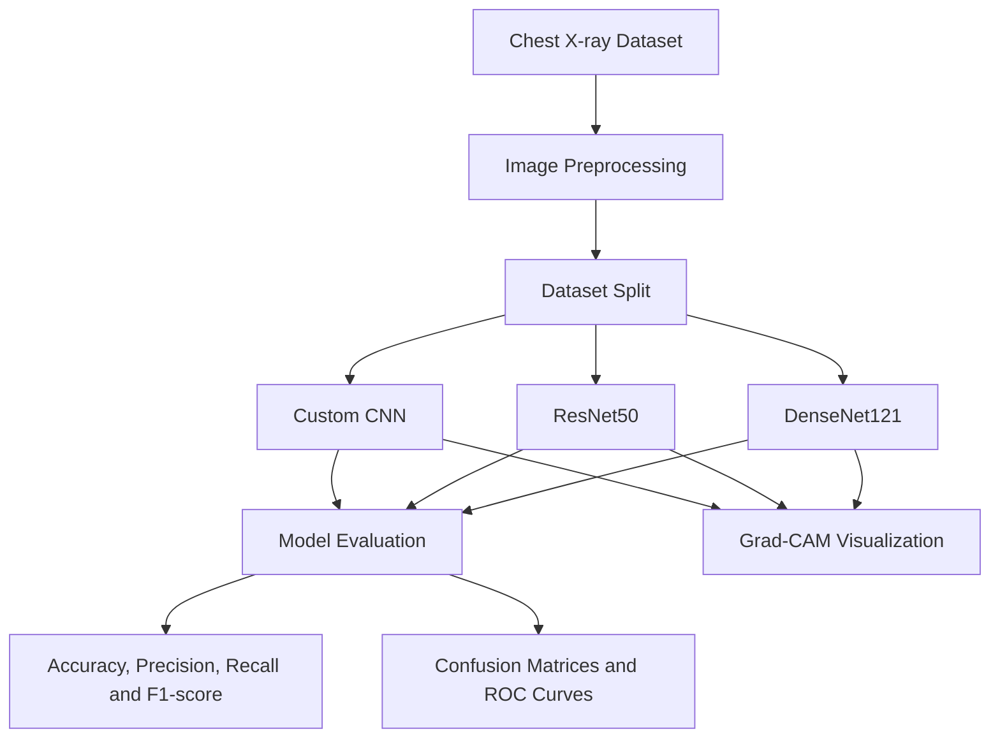

# COVID-19 Detection from Chest X-ray Images Using Deep Learning

## Project Overview

This project presents a deep-learning-based approach for classifying chest X-ray images into four different lung conditions: **COVID, Normal, Viral Pneumonia, and Lung Opacity**.

The system implements and compares three Convolutional Neural Network (CNN) architectures:

- Custom Convolutional Neural Network (Custom CNN)
- ResNet50
- DenseNet121

The models are trained and evaluated using a dataset containing **21,165 chest X-ray images**. Their performance is compared using accuracy, precision, recall, F1-score, and ROC-AUC.

The project also incorporates **Grad-CAM (Gradient-weighted Class Activation Mapping)** to visualize important image regions influencing model predictions.

**Project Type:** Deep Learning / Medical Image Classification  
**Classification Type:** Multi-class Classification  
**Number of Classes:** 4  
**Input Image Size:** 224 × 224 pixels

---

## Objectives

The main objectives of this project are:

1. Develop a deep-learning-based system for chest X-ray image classification.
2. Classify chest X-ray images into four categories.
3. Implement a Custom CNN architecture.
4. Apply transfer learning using ResNet50 and DenseNet121.
5. Compare the performance of all three models.
6. Evaluate the models using multiple classification metrics.
7. Generate confusion matrices and ROC curves.
8. Apply Grad-CAM to understand the regions influencing model predictions.

---

## Dataset Description

The dataset contains **21,165 chest X-ray images** organized into four categories.

### Dataset Distribution

| Class | Number of Images |
|---|---:|
| COVID | 3,616 |
| Normal | 10,192 |
| Viral Pneumonia | 1,345 |
| Lung Opacity | 6,012 |
| **Total** | **21,165** |

### Dataset Structure

```text
data/
├── dataset/
│   ├── COVID/
│   │   ├── images/
│   │   └── masks/
│   ├── Normal/
│   │   ├── images/
│   │   └── masks/
│   ├── Viral Pneumonia/
│   │   ├── images/
│   │   └── masks/
│   └── Lung_Opacity/
│       ├── images/
│       └── masks/
│
└── dataset_splits.npz
```

**Note:** The current classification training pipeline uses chest X-ray images. The masks are present in the dataset folders but are not used by the current classification pipeline.

### Dataset Split

The dataset is divided into training, validation, and testing sets.

| Dataset | Images | Percentage |
|---|---:|---:|
| Training | 14,816 | 70% |
| Validation | 3,174 | 15% |
| Testing | 3,175 | 15% |
| **Total** | **21,165** | **100%** |

The same saved dataset split is used for all three models to ensure a consistent comparison.

---

## Project Architecture

The overall workflow of the proposed system is illustrated below.



---

## Image Preprocessing

Before training, chest X-ray images are processed using TensorFlow.

The preprocessing pipeline includes:

1. Loading image paths from the saved dataset split.
2. Reading images using TensorFlow.
3. Decoding images as grayscale.
4. Resizing images to 224 × 224 pixels.
5. Converting pixel values into floating-point format.
6. Normalizing pixel values to the range 0–1.
7. Creating batches of images.
8. Shuffling the training dataset.
9. Using prefetching to improve data-loading efficiency.

### Preprocessing Configuration

| Parameter | Value |
|---|---|
| Image Size | 224 × 224 |
| Channels | 1 |
| Color Mode | Grayscale |
| Batch Size | 8 |
| Normalization | 0–1 |
| Random Seed | 42 |

---

## Deep Learning Models

Three different CNN-based architectures are implemented and compared.

### 1. Custom CNN

A custom Convolutional Neural Network is developed for chest X-ray image classification.

The architecture uses convolutional layers to extract spatial features from chest X-ray images, followed by classification layers to predict the corresponding disease category.

**Main components:**

- Convolutional layers
- Activation functions
- Pooling layers
- Feature extraction
- Fully connected layers
- Dropout regularization
- Softmax classification output

The Custom CNN learns image features directly from the training dataset.

### 2. ResNet50

ResNet50 is a deep convolutional neural network based on residual learning.

It uses residual connections that help information flow through deeper network layers and support the learning of complex image features.

In this project, ResNet50 is applied to chest X-ray classification using transfer learning.

**Main characteristics:**

- 50-layer residual network
- Residual connections
- Pre-trained feature extraction
- Classification layer for four categories
- Transfer learning approach

### 3. DenseNet121

DenseNet121 is a convolutional neural network that uses dense connectivity between layers.

Each layer receives feature information from preceding layers, encouraging feature reuse and improving information flow through the network.

In this project, DenseNet121 is used as a feature extractor with a trainable classification head.

**Main characteristics:**

- Dense connectivity
- Feature reuse
- Pre-trained feature extraction
- Global average pooling
- Dropout regularization
- Four-class classification output

---

## Model Training

All three models are trained and evaluated using the same saved dataset split.

### Training Configuration

| Parameter | Value |
|---|---|
| Framework | TensorFlow / Keras |
| Input Image Size | 224 × 224 |
| Image Channels | 1 |
| Batch Size | 8 |
| Number of Classes | 4 |
| Dataset Split | 70% / 15% / 15% |
| Random Seed | 42 |
| Loss Function | Categorical Crossentropy |
| Optimizer | Adam |

Class weighting is used in the training pipeline to help address differences in the number of images across the four categories.

---

## Model Evaluation

The models are evaluated using the following performance metrics.

### Accuracy

Measures the proportion of correctly classified images among all tested images.

### Precision

Measures how many images predicted as a particular class actually belong to that class.

### Recall

Measures how many actual images belonging to a class are correctly identified.

### F1-score

Represents the harmonic mean of precision and recall.

### ROC-AUC

Measures the ability of a classification model to distinguish between classes using the Receiver Operating Characteristic curve and Area Under the Curve.

The macro averages are used to compare overall performance across the four classes.

---

## Experimental Results

All models were evaluated using the same test dataset containing **3,175 images**.

### Overall Model Performance

| Metric | Custom CNN | ResNet50 | DenseNet121 |
|---|---:|---:|---:|
| Accuracy | **91.81%** | **91.81%** | 87.09% |
| Macro Precision | 0.9254 | **0.9258** | 0.8658 |
| Macro Recall | **0.9315** | 0.9213 | 0.8907 |
| Macro F1-score | **0.9283** | 0.9235 | 0.8774 |
| Macro ROC-AUC | **0.9875** | 0.9871 | 0.9746 |

### Class-wise ROC-AUC Comparison

| Class | Custom CNN | ResNet50 | DenseNet121 |
|---|---:|---:|---:|
| COVID | **0.9991** | 0.9950 | 0.9775 |
| Normal | 0.9761 | **0.9775** | 0.9592 |
| Viral Pneumonia | 0.9987 | **0.9989** | 0.9986 |
| Lung Opacity | 0.9760 | 0.9768 | 0.9631 |

### Result Analysis

The experimental results show that:

1. Custom CNN and ResNet50 achieved the highest test accuracy of 91.81%.
2. Custom CNN achieved the highest macro recall of 0.9315.
3. Custom CNN achieved the highest macro F1-score of 0.9283.
4. Custom CNN achieved the highest macro ROC-AUC of 0.9875.
5. ResNet50 achieved slightly higher macro precision than the other models.
6. DenseNet121 achieved an accuracy of 87.09% in the current experiment.

Based on the evaluated metrics, **Custom CNN demonstrated the strongest overall performance** in this experiment, while ResNet50 achieved comparable accuracy.

---

## Confusion Matrix and ROC Curve Analysis

Confusion matrices are generated to examine the classification performance of each model across the four categories.

They help identify:

- Correctly classified images.
- Incorrectly classified images.
- Classes that are more difficult to distinguish.
- Patterns of confusion between disease categories.

ROC curves are also generated to compare the classification performance of the models.

The class-wise and overall ROC-AUC values provide additional information about the models' ability to distinguish between the four categories.

---

## Grad-CAM Visualization

Grad-CAM is used to provide visual explanations of model predictions.

It generates heatmaps that highlight image regions that contribute to a model's prediction.

In this project, Grad-CAM is applied to the CNN models to inspect the regions influencing their classification outputs.

**Purpose of Grad-CAM:**

- Visualize important image regions.
- Improve interpretability of model predictions.
- Examine which regions influence classification.
- Support qualitative analysis of model behaviour.

Grad-CAM visualizations are intended for model interpretation and do not establish clinical validity.

---

## Technologies Used

| Technology | Purpose |
|---|---|
| Python | Programming language |
| TensorFlow | Deep learning framework |
| Keras | Neural network implementation |
| NumPy | Numerical operations |
| Pandas | Data handling |
| Matplotlib | Data visualization |
| Scikit-learn | Model evaluation |
| Pillow | Image processing |
| h5py | Model and weight file support |
| Git | Version control |
| GitHub | Project hosting |

---

## Project Folder Structure

```text
Advanced-COVID19-Detection-CNN/
│
├── src/
│   ├── 01_config.py
│   ├── 02_*.py
│   ├── 03_*.py
│   ├── ...
│   └── 16_model_comparison.py
│
├── results/
│   ├── custom_cnn/
│   ├── resnet50/
│   ├── densenet121/
│   └── comparison/
│
├── README.md
├── requirements.txt
└── .gitignore
```

**Note:** The dataset, saved dataset split, trained model files, logs, virtual environment, and old backup results are excluded from the public GitHub repository. The folder structure above represents the main project organization; the local project also contains additional files and directories.

---

## Installation and Setup

### 1. Clone the Repository

```bash
git clone https://github.com/santhoshmadhavan016-ops/Advanced-COVID19-Detection-CNN.git
```

### 2. Open the Project Directory

```bash
cd Advanced-COVID19-Detection-CNN
```

### 3. Create a Virtual Environment

```bash
python -m venv .venv
```

### 4. Activate the Virtual Environment

**Windows:**

```bash
.venv\Scripts\activate
```

### 5. Install Dependencies

```bash
python -m pip install -r requirements.txt
```

---

## Running the Project

The source scripts are available in the `src/` directory.

To run a script, use the following format:

```bash
python src/script_name.py
```

For example, the model comparison script can be run using:

```bash
python src/16_model_comparison.py
```

**Important:** Running training, evaluation, and Grad-CAM scripts requires the dataset, saved dataset split, and corresponding trained model files. These files are not included in the public repository.

---

## Limitations

- The dataset contains an unequal number of images across the four classes.
- Model performance depends on dataset quality and image characteristics.
- The current system uses chest X-ray images for classification.
- Grad-CAM provides visual explanations but does not guarantee that the highlighted regions represent medically meaningful features.
- The models have not been clinically validated.
- The experimental results should not be considered a substitute for professional medical diagnosis.

---

## Future Enhancements

Possible future improvements include:

1. Increasing the diversity and size of the dataset.
2. Applying additional data augmentation techniques.
3. Fine-tuning pre-trained model layers.
4. Exploring more advanced CNN architectures.
5. Improving the classification performance of underrepresented classes.
6. Developing a web-based interface for image classification.
7. Improving explainability using additional visualization techniques.
8. Conducting external validation using independent datasets.

---

## Conclusion

This project implements and compares three deep learning architectures for four-class chest X-ray image classification: Custom CNN, ResNet50, and DenseNet121.

The models were evaluated using accuracy, precision, recall, F1-score, and ROC-AUC. Among the three models, Custom CNN achieved the strongest overall results in the current experiment, with 91.81% accuracy and a macro F1-score of 0.9283.

Grad-CAM was also incorporated to visualize regions influencing model predictions.

The project demonstrates the application of deep learning, transfer learning, model evaluation, and explainable AI techniques in medical image classification.

**Disclaimer:** This project is developed for academic and research purposes only. It is not intended for clinical diagnosis or medical decision-making.

---

## Author

**Santhosh Madhavan R**  
B.Tech – Computer Science and Engineering (AI & DS)  
Joy University

## GitHub Repository

[Advanced COVID-19 Detection using Deep Learning](https://github.com/santhoshmadhavan016-ops/Advanced-COVID19-Detection-CNN)