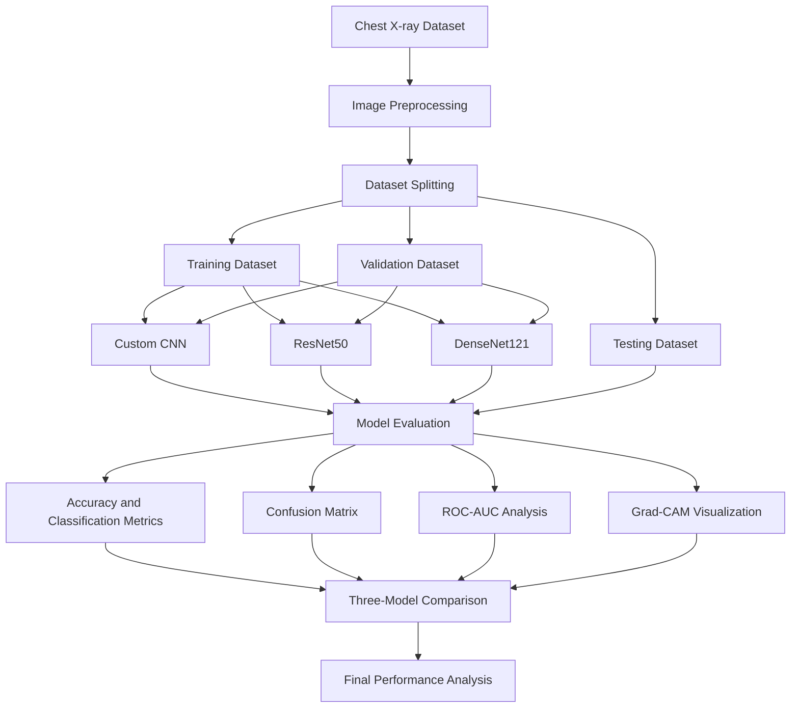

# COVID-19 Detection from Chest X-ray Images Using Deep Learning

## Project Overview

This project presents a deep-learning-based approach for classifying chest X-ray images into four different lung conditions: COVID, Normal, Viral Pneumonia, and Lung Opacity.

The system implements and compares three convolutional neural network architectures:

- Custom Convolutional Neural Network (Custom CNN)
- ResNet50
- DenseNet121

The models are trained and evaluated using a dataset containing 21,165 chest X-ray images. Their performance is compared using accuracy, precision, recall, F1-score, and ROC-AUC.

The project also incorporates Grad-CAM (Gradient-weighted Class Activation Mapping) to visualize important image regions influencing model predictions.

**Project Type:** Deep Learning / Medical Image Classification

**Classification Type:** Multi-class Classification

**Number of Classes:** 4

**Input Image Size:** 224 × 224 pixels

---

## Objectives

The main objectives of this project are:

1. Develop a deep-learning-based system for chest X-ray image classification.
2. Classify chest X-ray images into four categories.
3. Implement a Custom CNN architecture.
4. Apply transfer learning using ResNet50 and DenseNet121.
5. Compare the performance of all three models.
6. Evaluate the models using multiple classification metrics.
7. Generate confusion matrices and ROC curves.
8. Apply Grad-CAM to understand the regions influencing model predictions.

---

## Dataset Description

The dataset contains 21,165 chest X-ray images organized into four categories.

### Dataset Distribution

| Class | Number of Images |
|---|---:|
| COVID | 3,616 |
| Normal | 10,192 |
| Viral Pneumonia | 1,345 |
| Lung Opacity | 6,012 |
| **Total** | **21,165** |

### Dataset Structure

```text
data/
├── dataset/
│   ├── COVID/
│   │   ├── images/
│   │   └── masks/
│   ├── Normal/
│   │   ├── images/
│   │   └── masks/
│   ├── Viral Pneumonia/
│   │   ├── images/
│   │   └── masks/
│   └── Lung_Opacity/
│       ├── images/
│       └── masks/
│
└── dataset_splits.npz
```

**Note:** The current training pipeline loads chest X-ray images. The masks are present in the dataset folders but are not used by the current classification training pipeline.

### Dataset Split

The dataset is divided into training, validation, and testing sets.

| Dataset | Images | Percentage |
|---|---:|---:|
| Training | 14,816 | 70% |
| Validation | 3,174 | 15% |
| Testing | 3,175 | 15% |
| **Total** | **21,165** | **100%** |

The same saved dataset split is used for evaluating all three models.

---

## Project Architecture

The overall workflow of the proposed system is illustrated below.



---

## Image Preprocessing

Before training, chest X-ray images are processed using TensorFlow.

The preprocessing pipeline includes:

1. Loading image paths from the saved dataset split.
2. Reading images using TensorFlow.
3. Decoding images as grayscale.
4. Resizing images to 224 × 224 pixels.
5. Converting pixel values to floating-point format.
6. Normalizing pixel values to the range 0–1.
7. Creating batches of images.
8. Shuffling the training dataset.
9. Using prefetching to improve data-loading efficiency.

### Preprocessing Configuration

| Parameter | Value |
|---|---|
| Image Size | 224 × 224 |
| Channels | 1 |
| Color Mode | Grayscale |
| Batch Size | 8 |
| Normalization | 0–1 |
| Random Seed | 42 |

---

## Deep Learning Models

Three different CNN-based architectures are implemented and compared.

### 1. Custom CNN

A custom Convolutional Neural Network is developed for chest X-ray image classification.

The architecture uses convolutional layers to extract spatial features from chest X-ray images, followed by classification layers to predict the corresponding disease category.

Main components:

- Convolutional layers
- Activation functions
- Pooling layers
- Feature extraction
- Fully connected